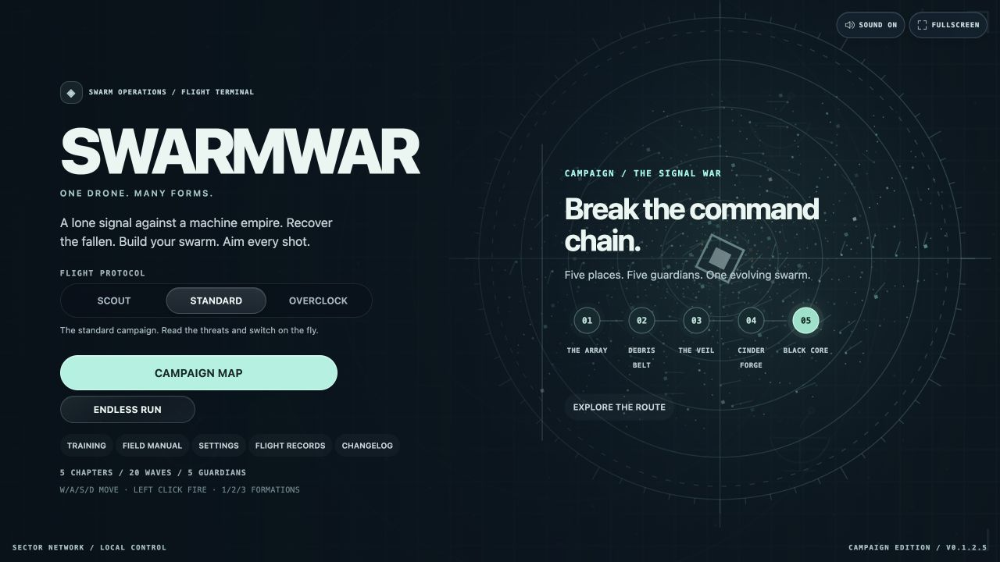

# SWARMWAR v0.1.2.7 — The Signal War

A fullscreen vector action game about turning one drone into a coordinated swarm. **Every weapon uses manual aim and trigger input.** Move, collect wreckage, reshape the swarm, and choose a build across five chapters.

**Standard campaign field fixes.** [Play online](https://leolunelove.github.io/swarmwar/) · [Download v0.1.2.5](https://github.com/leolunelove/swarmwar/releases/tag/v0.1.2.5) · [Release notes](RELEASE_NOTES.md)



## Play

Open **[Play Swarmwar.html](Play%20Swarmwar.html)** in a current browser. The file is self-contained and works offline. Choose **Campaign Map → Start Full Campaign**, or inspect a chapter and choose **Practice This Chapter**. The arena fills the viewport; **F** optionally enters native fullscreen. Browser refusal falls back to the full window. Resizing the play area pauses combat; resume explicitly once the new size is stable.

| Input | Action |
| --- | --- |
| WASD / arrows | Move |
| Mouse | Aim, without target snapping |
| Hold left click | Fire Ring; throw cutters and engage Blades |
| Click and release left click | Release Spear's automatically assembled skill shot |
| 1 / 2 / 3, or Q / E | Select / cycle formations |
| Space | Launch aimed Kamikaze payload |
| P / Esc | Toggle pause and resume (Esc may exit native fullscreen) |
| H while paused | Inspect the frozen battlefield |
| F | Toggle native fullscreen |

Touch: left drag moves, right drag aims and fires; lifting the right finger releases Spear. Standard gamepad: left stick moves, right stick aims, RT fires Ring/Blades, press/release RT releases Spear's stored charge, bumpers cycle, A launches Kamikaze, Start pauses. Keyboard movement and formation bindings can be remapped in Settings. Hardware touch and gamepad testing remains outstanding; their input paths are covered by the client harness.

## The campaign

Five chapters, **four named waves and a guardian in each**, twenty waves, five guardian encounters, and nineteen upgrade choices. Automated runs take about 18–19 active minutes; human play time varies. Between chapters the route chart holds the action until you deploy. Your build carries forward, with 32 hull restored and five reserve drones. Wave breaks bank wreckage, restore six hull, and offer a module. The fourth wave gives way to a distinct guardian arrival break.

| Chapter | Place and encounter identity | Guardian |
| --- | --- | --- |
| The Array | Listening towers, ranged patrols, broken shock rings | Array Warden |
| Debris Belt | Wrecked convoy, crossing debris lanes, splitter packs | Belt Reaver |
| The Veil | Signal archive, beam casters, slow corridor walls | The Archivist |
| Cinder Forge | Furnace ribs, shield anchors, paired heat vents | The Crucible |
| Black Core | Reactor conduits, surge cells, moving corridor walls | Core Sovereign |

The Archivist and Crucible adapt the Warden and Reaver silhouettes with distinct attack sequences and colors. They are encounter variants, not five entirely separate boss engines.

Practice launches any chapter with a supplied swarm and foundation modules. It does **not** count as a campaign clear. Scout, Standard, and Overclock alter the protocol. Endless repeats the route with shorter waves and rising pressure. Completing the campaign unlocks Boss Rush.

## Weapons and growth

- **Ring:** intercept ordinary bullets; captures store three cells. Each shot has an exact 28-damage center bolt; additional wings deal 16. Your next manual shot spends the full bank on a stronger fan. Mirror empowers manually fired shots; Gravity creates defensive slowing wells.
- **Spear:** automatically assembles while equipped. Aim and click/release to shoot; a quarter charge permits a weaker shot. Charge stays stored across formation changes, pause and cancelled input. Rails pierce armor and interrupt ordinary wind-ups. Siege takes longer for more power; Arc adds two fixed-angle branches. There is no target search or automatic firing at full charge.
- **Blades:** hold the trigger to engage real rotating cutting arcs and throw short-range cutters. Movement increases the sweep rate. Release disengages damage. Long Orbit trades damage for reach; Vortex trades reach for stronger pulling cuts.
- **Kamikaze:** spend four drones and charge on an aimed explosive carrier. Cluster spreads three smaller charges; Cryo leaves a slowing field. It never selects an enemy automatically.

Fabrication costs two parts early, three at medium size, and four at large size. Capacity expands through all twenty waves, reaching 183 before Foundry bonuses. Twenty-four modules include foundation upgrades, prerequisite evolutions, and eight alternative cores. Each weapon has one core slot per run. Phase Conductor primes the next deliberate shot when you change formation; switching alone fires nothing.

Mint marks identify safe geometric openings. Ring blocks bullets, **not** beams, shock rings, walls, body contact, or heat vents. Warnings lock before attacks release; formation advice never takes control of your aim.

## Saves and release history

Wave checkpoints, settings, records and badges live in browser storage. Save & Exit resumes the latest wave start. Retry Wave restores at least 65% hull, deducts 20% of score and marks the clear rank R. Clean records require no retries.

The earlier 2.x labels were development milestones; v0.1.2.5 begins the numbered preview releases. The browser save format is unchanged. Five-chapter records are separated from the older three-sector campaign. Old checkpoints retain their original sector as **legacy runs** and cannot set five-chapter records or badges. The menu's **Changelog** lists the current release and prior milestones.

## Build and verify

No install or third-party runtime dependencies are needed to play.

```sh
python3 build.py
python3 tests/check.py
python3 tests/check.py --stress
```

The build inlines `src/` into the offline HTML and copies it to `docs/index.html` for GitHub Pages. Never edit generated HTML directly. Checks cover simulation rules, manual weapon intent, phase order in every chapter, checkpoint migration, the packaged UI, full automated campaign and Boss Rush, and optional long-run bounded-state stress. Automated controllers do not establish human balance or win rates.

See [PROJECT_STATUS.md](PROJECT_STATUS.md) for a concise handoff, [DESIGN.md](DESIGN.md) for current rules, [VISUAL_AUDIT.md](VISUAL_AUDIT.md) for the five observed clarity problems, and [PLAYTEST.md](PLAYTEST.md) for verification history.

Developed using the [AI Prompts for Game Development](https://github.com/Glitch-Gaming-Platform/AI-Prompts-For-Game-Development) workflow. Visual direction: minimal geometric combat, mint swarm trails, warm hostile patterns, and restrained glass menus.

## Build a release

`VERSION` is the release number used by the menu, changelog, HTML metadata and generated `docs/release.json`. Run `python3 tests/check.py --stress`, then `python3 package_release.py`. The latter creates `dist/SWARMWAR-v<version>.zip` and `dist/SHA256SUMS.txt`; the ZIP includes the game, instructions and release manifest.

The game has no external runtime assets or build dependencies. A fresh public v0.1.2.6 Standard campaign completed all twenty waves and five guardians in 18:49, with manual aim/fire, inspection pauses and zero checkpoint retries. The debrief recorded 146,193 points, 703 enemies defeated and 150 peak drones. v0.1.2.7 fixes the input and interface problems observed during that run; the entire campaign was not repeated after those fixes. Evidence and validation limits are in [PLAYTEST.md](PLAYTEST.md).
